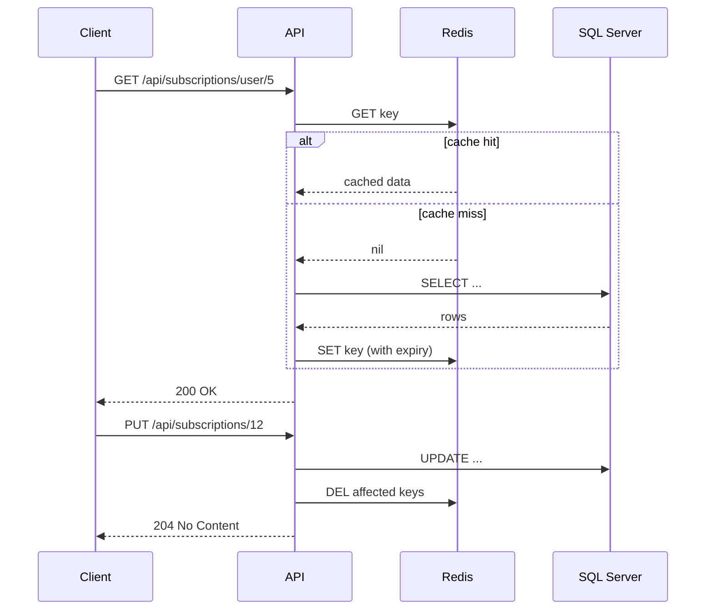
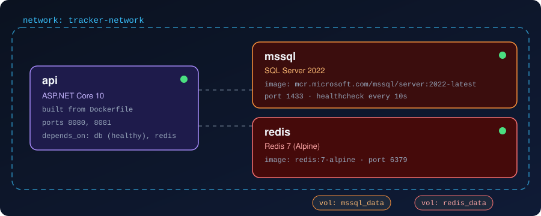
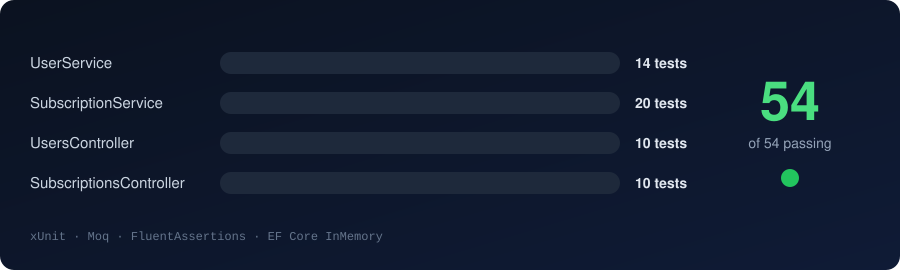

<div align="center">



<br/>


[](#)


<br/><br/>

**A REST API for tracking personal subscriptions and recurring expenses.**
Built to learn backend development properly: layered design, a real database, caching, containers and tests.

[Quick start](#quick-start) · [Architecture](#architecture) · [How Redis is used](#how-redis-is-used) · [Docker setup](#docker-setup) · [Endpoints](#api-endpoints) · [Tests](#testing)

</div>

<br/>

<!-- Replace with a GIF (10-15 s): open Swagger, POST a user, POST a subscription, GET it back twice -->
<!-- UNCOMMENT after adding the file
<p align="center">
  
</p>
-->

---

## About the project

Most people lose track of what they pay for every month: streaming, cloud storage, dev tools, gym. This API lets a user register, add their subscriptions in any currency, group them by category, and query them back by user or by name.

The domain is intentionally simple. The point of the project was everything around it. When I started, I had not worked with Redis or Docker before, so I picked this project to learn them by actually using them: first getting the API to run on its own, then putting SQL Server in a container, then adding a cache in front of it and figuring out when cached data has to be thrown away. The README below describes what ended up in the repo and the reasoning behind it.

## What it does

- **Users**: register with a unique email, read, update and delete profiles, look up by email.
- **Subscriptions**: full CRUD, multiple currencies, categories, payment dates, filtering by user and by name.
- **Caching**: frequently read data is served from Redis, and invalidated whenever it changes.
- **Health endpoint**: `/health` reports the state of the app and its dependencies.
- **Interactive docs**: Swagger UI is served at the root URL.
- **Everything in containers**: API, SQL Server and Redis start together with a single `docker compose up`.

## Tech stack

| Area | Technology |
|---|---|
| Framework | ASP.NET Core 10, C# 12 |
| Database | SQL Server 2022 |
| ORM | Entity Framework Core 10 (code-first migrations) |
| Cache | Redis 7 (Alpine image) |
| Containers | Docker, Docker Compose, multi-stage Dockerfile |
| Testing | xUnit, Moq, FluentAssertions, EF Core InMemory |
| API docs | OpenAPI / Swagger |

---

## Quick start

You only need Docker installed.

<p align="center">
  
</p>

```bash
git clone https://github.com/MIhajloS07/Personal-Finance-Subscription-Tracker-Web-API.git
cd Personal-Finance-Subscription-Tracker-Web-API

cp .env.example .env        # set your own SQL Server password in .env

docker compose up --build
```

| What | Where |
|---|---|
| Swagger UI | http://localhost:8080 |
| Health check | http://localhost:8080/health |
| SQL Server | `localhost:1433` |
| Redis | `localhost:6379` |

Stop everything with `docker compose down` (add `-v` to also wipe the database and cache volumes).

<details>
<summary><b>Run without Docker</b></summary>

Requirements: .NET 10 SDK, a running SQL Server instance and a running Redis instance. Update the connection strings in `appsettings.Development.json`, then:

```bash
dotnet restore
dotnet ef database update
dotnet run
```

</details>

---

## Architecture

The project uses a layered structure. Controllers only deal with HTTP, services hold the business rules, and `AppDbContext` is the only place that talks to SQL Server. Services depend on interfaces (`IUserService`, `ISubscriptionService`, `ICacheService`), which are registered through dependency injection. That is also what makes the services easy to test with mocks.

<p align="center">
  
</p>

The animation above shows both paths a read request can take: a cache hit (green) and a cache miss (orange).

```
.
├── Controllers/     HTTP endpoints (Users, Subscriptions)
├── Services/        Business logic, interfaces and implementations, Redis cache service
├── DTOs/            Request and response contracts, kept separate from entities
├── Model/           Domain entities (User, Subscription)
├── Data/            AppDbContext and EF Core configuration
├── Migrations/      EF Core migrations
├── Utils/           Helpers
├── Tests/           Unit tests, fixtures and test data generators
├── Dockerfile
├── docker-compose.yml
└── Program.cs       Composition root and DI setup
```

A few decisions worth mentioning:

- **DTOs everywhere.** Entities are never returned directly, so the database schema can change without breaking the API contract.
- **Cache behind an interface.** Services depend on `ICacheService`, not on the Redis client. In tests it is a mock, in production it is `RedisCacheService`.
- **Async all the way down.** Every service and controller method is async, so threads are not blocked while waiting on the database or the cache.

---

## How Redis is used

This was the part I had to learn from scratch. I use the **cache-aside** pattern: the application checks Redis first, falls back to SQL Server on a miss, and then stores the result for next time. On every write, the affected cache entries are removed so the next read loads fresh data.

<p align="center">
  
</p>

The same flow as a sequence diagram:



The hardest part was not reading from the cache but invalidating it correctly. A subscription belongs to a user, so changing one subscription means both the single-item entry and the per-user list have to be cleared. Getting that wrong gives you stale data, which is worse than no cache at all.

<!-- Add a real screenshot of redis-cli here -->
<!-- UNCOMMENT after adding the file
<p align="center">
  
</p>
-->

You can watch it work yourself:

```bash
# list cached keys
docker exec -it finance-cache redis-cli KEYS "*"

# see every command the API sends to Redis in real time
docker exec -it finance-cache redis-cli MONITOR

# check how long an entry will live
docker exec -it finance-cache redis-cli TTL <key>
```

Call the same GET endpoint twice while `MONITOR` is running: the first request goes to SQL Server and writes a key, the second is answered from Redis.

---

## Docker setup

`docker-compose.yml` starts three services on a shared network. The API waits for SQL Server to report healthy before it starts, so migrations don't fail on a database that is still booting.

<p align="center">
  
</p>

- **Persistent volumes** for SQL Server and Redis, so data survives container restarts.
- **Health check** on SQL Server, and the API depends on it.
- **Secrets in `.env`**, which is git-ignored. Only `.env.example` is committed.
- **Multi-stage Dockerfile**: the SDK image compiles and publishes the app, and the final image contains only the ASP.NET runtime and the published output, which keeps it small.

<!-- Add a screenshot of `docker compose ps` or Docker Desktop showing the three containers running -->
<!-- UNCOMMENT after adding the file
<p align="center">
  
</p>
-->

---

## API endpoints

Full interactive documentation is in Swagger at `/`.

**Users**

| Method | Route | Description |
|---|---|---|
| GET | `/api/users` | List all users |
| GET | `/api/users/{id}` | Get user by id |
| GET | `/api/users/by-email/{email}` | Get user by email |
| POST | `/api/users` | Create user |
| PUT | `/api/users/{id}` | Update user |
| DELETE | `/api/users/{id}` | Delete user |

**Subscriptions**

| Method | Route | Description |
|---|---|---|
| GET | `/api/subscriptions` | List all subscriptions |
| GET | `/api/subscriptions/{id}` | Get subscription by id |
| GET | `/api/subscriptions/user/{userId}` | All subscriptions of a user |
| GET | `/api/subscriptions/by-name/{name}` | Find by name |
| POST | `/api/subscriptions` | Create subscription |
| PUT | `/api/subscriptions/{id}` | Update subscription |
| DELETE | `/api/subscriptions/{id}` | Delete subscription |

**System**

| Method | Route | Description |
|---|---|---|
| GET | `/health` | Service health |

Example request:

```bash
curl -X POST http://localhost:8080/api/subscriptions \
  -H "Content-Type: application/json" \
  -d '{
        "userId": 1,
        "name": "Netflix",
        "category": "Streaming",
        "amount": 12.99,
        "currency": "EUR",
        "nextPaymentDate": "2026-12-01"
      }'
```

> Adjust the field names to match your DTOs if they differ.

<!-- Screenshot of Swagger UI with the endpoint list expanded -->
<!-- UNCOMMENT after adding the file
<p align="center">
  
</p>
-->

---

## Testing

```bash
dotnet test
```

<p align="center">
  
</p>

There are 54 unit tests covering the service layer and the controllers:

| Suite | Tests |
|---|---|
| `UserService` | 14 |
| `SubscriptionService` | 20 |
| `UsersController` | 10 |
| `SubscriptionsController` | 10 |

Service tests run against EF Core's in-memory provider through a shared `DatabaseFixture`, so they need no SQL Server. The cache is replaced with a Moq mock of `ICacheService`, which lets the tests check that entries are read and invalidated at the right moments. Assertions use FluentAssertions, and tests follow Arrange-Act-Assert:

```csharp
[Fact]
public async Task CreateAsync_WithDuplicateEmail_ShouldReturnNull()
{
    // Arrange
    await _fixture.ClearAsync();
    await _userService.CreateAsync(new CreateUserDto { Email = "a@b.com", Password = "secret123" });

    // Act
    var result = await _userService.CreateAsync(new CreateUserDto { Email = "a@b.com", Password = "secret123" });

    // Assert
    result.Should().BeNull();
}
```

<!-- Screenshot of the terminal with `dotnet test` output -->
<!-- UNCOMMENT after adding the file
<p align="center">
  
</p>
-->

---

## What I learned

I wrote this section because the commit history alone doesn't show it.

- **Redis.** I started without knowing it. By the end I understood the cache-aside pattern, why expiry times matter, and why invalidation is the real difficulty. I also learned to debug it with `redis-cli` instead of guessing.
- **Docker.** Writing a multi-stage Dockerfile, wiring services together with Compose, using health checks so startup order is reliable, and keeping secrets out of the repository.
- **Entity Framework Core.** Code-first migrations, relationships and constraints (unique email, foreign keys), and keeping entities separate from DTOs.
- **Testing.** Designing services around interfaces from the start made them testable. Doing that after the fact would have been much more painful.
- **Debugging across services.** A request touches the API, the cache and the database, and when something is wrong you need to know which one to look at first.

## Known limitations and next steps

I'd rather list these than pretend they don't exist.

- [ ] Authentication and authorization (JWT) so users can only see their own data
- [ ] Pagination on list endpoints
- [ ] Integration tests against real SQL Server and Redis containers (Testcontainers)
- [ ] Monthly and yearly spending summaries per user
- [ ] Reminders for upcoming payments
- [ ] CI pipeline that builds, tests and builds the Docker image on every push

---

## License

Released under the [MIT License](LICENSE).

## Author

**Mihajlo S.**
[GitHub](https://github.com/MIhajloS07) · [Linkedin](https://www.linkedin.com/in/mihajlo-stoiljkovi%C4%87-aa1560355/) · mihajlostoiljkovic554@gmail.com
